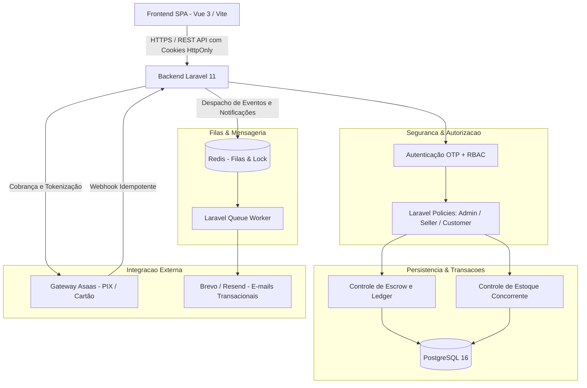

# Nexus Commerce ⚡

[](https://github.com/devraphaeldiniz/nexus-commerce/actions)
[](https://php.net)
[](https://laravel.com)
[](https://vuejs.org)
[](LICENSE)

Plataforma de marketplace multi-vendedor com custódia financeira (*escrow*), catálogo moderado e checkout protegido. O sistema resolve a complexidade de retenção e repasse seguro de fundos entre múltiplos lojistas e clientes, mitigando fraudes via controle de liberação pós-entrega e processamento assíncrono de webhooks.

---

## 🏗️ Arquitetura do Sistema



---

## ✨ Funcionalidades Principais

- **Marketplace Multi-Tenant:** Isolamento lógico de dados por vendedor com aprovação prévia obrigatória (`is_approved`) pelo perfil administrador.
- **Custódia Financeira (*Escrow*):** Retenção temporária do valor pago até a confirmação de entrega do produto pelo cliente ou resolução de disputas.
- **Webhooks com Idempotência Estrita:** Processamento de notificações de pagamento do Asaas com assinatura segura e chave de idempotência para evitar duplicidade de crédito.
- **Controle de Concorrência de Estoque:** Atualização de saldos de produtos em transações protegidas, impedindo *overselling*.
- **Autenticação Segura sem Exposição de Token:** Sessões gerenciadas via cookies `HttpOnly`, `Secure` e `SameSite`, prevenindo riscos de XSS no armazenamento de tokens em local storage.
- **Processamento Assíncrono:** Envio de e-mails, atualização de status de pedidos e conciliação executados em filas desacopladas no Redis.

---

## 🛠️ Stack Tecnológica & Decisões Técnicas

| Componente | Tecnologia | Decisão Técnica |
| :--- | :--- | :--- |
| **Backend** | Laravel 11 (PHP 8.4) | Ecossistema maduro para modelagem de domínio com Eloquent ORM, autorização declarativa via Policies e suporte nativo a filas robustas. |
| **Frontend** | Vue 3 + Vite + Tailwind | Single Page Application com carregamento rápido, gerenciamento de estado via Pinia e tipagem limpa. |
| **Banco Principal** | PostgreSQL 16 | Integridade referencial estrita, suporte a transações ACID complexas e tipos nativos avançados. |
| **Filas & Cache** | Redis | Gerenciamento de alta vazão para enfileiramento de jobs assíncronos e travas temporárias. |
| **Gateway de Pagamento** | Asaas (PIX / Cartão) | Provedor nacional com suporte a split de pagamento e webhooks de confirmação. |

---

## 🚀 Como Rodar o Projeto

### Opção 1: Via Docker Compose (Recomendado)
```bash
docker compose up -d --build
```
Após subir os containers:
```bash
docker compose exec app php artisan migrate --seed
```
Serviços disponíveis:
- Frontend: `http://localhost:5173`
- Backend API: `http://localhost:8000`
- PostgreSQL: `localhost:5432`
- Redis: `localhost:6379`

### Opção 2: Desenvolvimento Local
#### Backend
```bash
cd backend
composer install
cp .env.example .env
php artisan key:generate
php artisan migrate --seed
php artisan serve
```

#### Frontend
```bash
cd frontend
npm install
cp .env.example .env
npm run dev
```

---

## 🧪 Como Rodar os Testes

### Testes do Backend (Unitários e Integração)
```bash
cd backend
php artisan test
```

### Validação de Build do Frontend
```bash
cd frontend
npm run build
```

---

## 📊 Resultados e Métricas

- **Suíte de Testes Automatizados:** Cobertura de cenários de transição de status de pedidos, cálculo de taxas de escrow e autorização de policies executados via GitHub Actions.
- **Latência de Processamento de Webhooks:** `TODO: Conduzir testes de carga de disparo de webhooks concorrentes e medir tempo de resposta do endpoint de liquidação.`
- **Capacidade Máxima de Concorrência em Checkout:** `TODO: Documentar limite de requisições por segundo em checkout simultâneo.`

---

## ⚠️ Limitações e Próximos Passos

- [ ] Implementar integração direta de cálculo de frete dinâmico via API dos Correios / Melhor Envio.
- [ ] Adicionar suporte a estorno automático parcial diretamente pela interface de disputas.
- [ ] Implementar telemetria com exportação de métricas via OpenTelemetry.

---

## 📄 Licença

Distribuído sob a licença MIT. Consulte [LICENSE](LICENSE) para mais detalhes.
