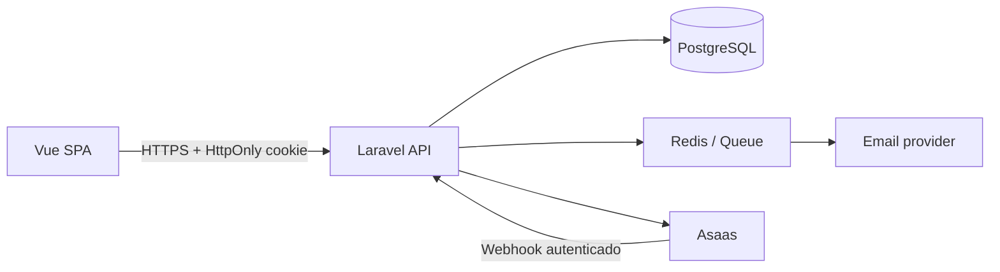

# Arquitetura

## Visão geral



## Domínios

| Domínio | Responsabilidade | Componentes |
|---|---|---|
| Identidade | Login, OTP, sessão e roles | `AuthController`, `AuthenticateApi` |
| Catálogo | Produtos, categorias e estoque | `Product`, `Category`, `SellerProductController` |
| Checkout | Validação de carrinho e criação de pedidos | `CheckoutController` |
| Pagamentos | Cobranças e reconciliação | `AsaasService`, webhook idempotente |
| Marketplace | Escrow, comissão e saldo do seller | migrations de ledger/escrow |
| Operação | Despacho, entrega e disputas | `OrderLifecycleController`, `DisputeController` |

## Princípios

- O backend é a fonte de verdade para preço, estoque, autorização e transições financeiras.
- O frontend nunca é responsável por segurança ou autorização.
- Webhooks são autenticados, persistidos e idempotentes.
- Operações financeiras utilizam transações e estados explícitos.
- Credenciais de sessão ficam em cookie `HttpOnly`.
- Dados de cartão não são persistidos; o fluxo deve receber token do provedor.

## Estados de pedido

```text
PENDING → PAID → PROCESSING → SHIPPED → DELIVERED → COMPLETED
   └──────────────→ CANCELLED
   └──────────────→ DISPUTED → REFUNDED
```

Toda transição deve verificar o estado atual, o ator autorizado e seus efeitos financeiros.

## Estrutura do repositório

```text
backend/
  app/              domínio, controllers, policies, services e jobs
  database/         migrations e seeders
  routes/           contrato HTTP
  tests/            testes de feature/unitários
frontend/
  src/views/        telas
  src/components/   UI reutilizável
  src/stores/       estado de carrinho e sessão
  src/router/       navegação e guards
.github/workflows/  CI de frontend e backend
docs/               arquitetura e decisões técnicas
```
